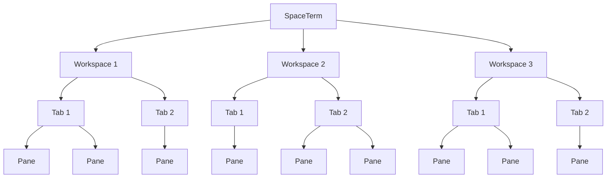

<picture>
  <source media="(prefers-color-scheme: dark)" srcset="assets/brand/logo/spaceterm-icon-dark.svg">
  
</picture>

# SpaceTerm

A native desktop terminal multiplexer for macOS and Linux, coming soon for Windows.


## Highlights

- **Workspaces** for local and remote terminal work
- **Tabs and Panes** with recursive splits, focus, resize, and zoom
- **Remote terminals** over paired, encrypted QUIC connections on UDP port 9231
- **Keyboard-first navigation** through the Command Palette and Workspace Switcher

## Install

### On a Mac

SpaceTerm runs on Apple silicon Macs with macOS 26 or later. Download the disk image from the [latest release](https://github.com/sadiksaifi/SpaceTerm/releases/latest), open it, and drag SpaceTerm into Applications. If you use Homebrew, one command does the same:

```sh
brew install --cask sadiksaifi/tap/spaceterm
```

Every Mac build is signed with a Developer ID and notarized by Apple, so macOS opens it without any workarounds. From then on, SpaceTerm keeps itself up to date.

### On Linux

SpaceTerm runs on x86_64 Linux with glibc 2.35 or newer, such as Ubuntu 22.04 and later. This command installs the app and SpaceTerm Core into your home directory:

```sh
curl -fsSL https://github.com/sadiksaifi/SpaceTerm/releases/latest/download/install.sh | sh -s -- --desktop
```

The installer checks the checksum and signature of everything it downloads before it unpacks or runs any of it. On a machine you only connect to from elsewhere, leave out `--desktop`. You get SpaceTerm Core on its own, and `spaceterm setup` starts it.

If you would rather not pipe a script into your shell, each release also carries the Linux desktop as a `.tar.gz`. Unpack it and start `bin/spaceterm-desktop`. You can check that a downloaded archive or disk image came from this repository's release workflow with `gh attestation verify FILE --repo sadiksaifi/SpaceTerm`.

## Workspace hierarchy



## Add a remote Machine

Open Settings > Machines > Add Machine… and use your existing OpenSSH configuration or an Invitation Link. SSH installs and starts SpaceTerm Core on that computer, pairs it, then closes. SpaceTerm uses the saved QUIC connection, on UDP port 9231 by default, for remote work, so that UDP port must be reachable from your computer. Create Workspaces and browse directories on your added Machines from either sidebar creation menu.

## Copy and paste over SSH and tmux

Programs can copy to your clipboard even when they run on another machine.
Neovim and tmux each need a setting first. See [terminal clipboard setup](docs/terminal-clipboard.md).

## For program authors

A program running in SpaceTerm can offer macOS permission setup with a
[Permission Request](docs/permission-request.md).
